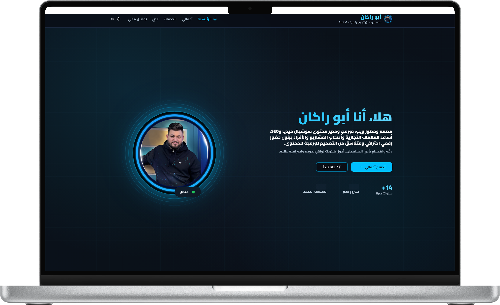
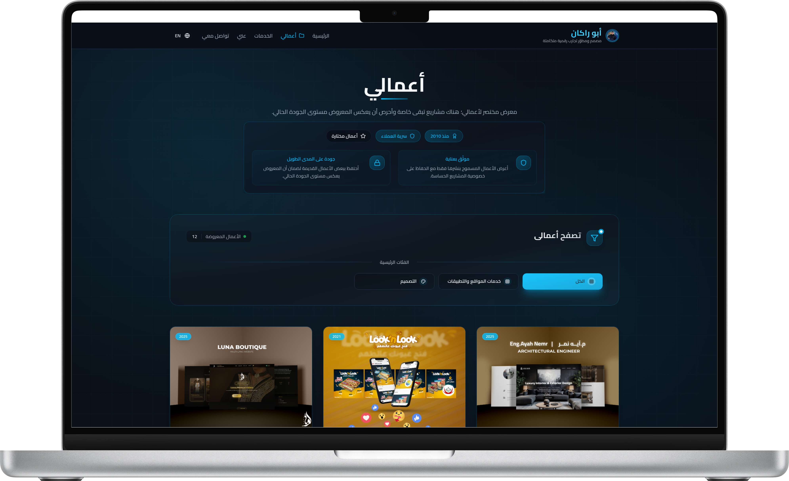
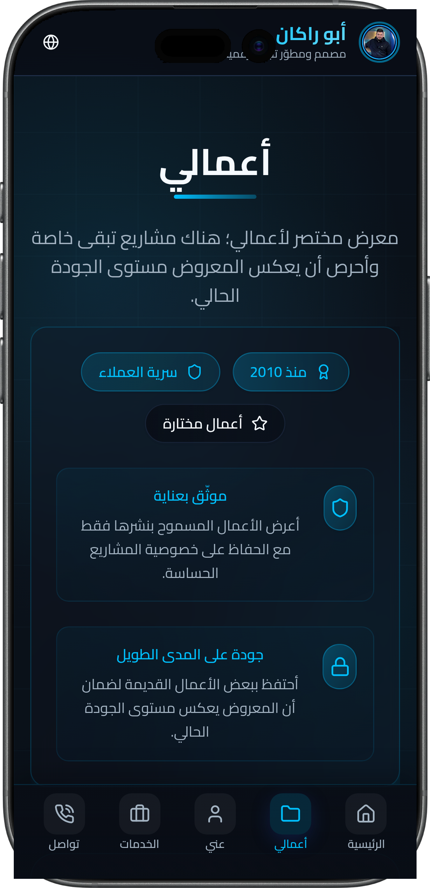

# Mawahab Portfolio - a portfolio that runs itself

A bilingual (Arabic / English, full RTL) personal portfolio with a **complete self-hosted CMS**: every project, service, category, testimonial and message on the public site is managed from a built-in admin panel - no code changes, no redeploys, no third-party site builder.

**Live:** https://mawahab.vercel.app



## Why it exists

Freelance portfolios usually rot: the work is current, the website is not. This project treats the portfolio as a product - a fast public front-end for clients, backed by a real content-management system and a proper API, so updating the site is an admin task, not a development task.

## Features

**Public site**
- Bilingual AR / EN with full RTL layout and a language toggle
- Project showcase with category filtering and per-project galleries
- Services, about and contact pages, all driven by the API (nothing hard-coded)
- Testimonial submission flow with tokenised client links
- Fully responsive, mobile-first navigation, PWA service worker

**Admin CMS** (JWT-authenticated)
- Dashboard with content overview
- Projects: full CRUD, categories, galleries, ordering, publish state
- Services and categories management
- Testimonials moderation
- Contact-message inbox
- Site settings (identity, contact channels, socials) editable from the panel

## Screenshots

| Desktop | Mobile |
| --- | --- |
|  |  |
|  |  |

## Tech stack

| Layer | Technology |
| --- | --- |
| Front-end | React 18, Vite 5, TypeScript |
| Styling / UI | Tailwind CSS 3, Radix UI, Framer Motion, Lucide icons |
| State / data | TanStack Query, React Router 6, react-i18next |
| API | Express 4 (TypeScript), REST |
| Database | PostgreSQL (`pg`) |
| Auth | JWT + bcryptjs password hashing |
| Media | Hosted image storage served as public URLs |
| Deployment | Vercel (front-end + API), service-worker PWA |

## Architecture

```
src/            React front-end (public site + admin panel)
server/         Express API (auth, projects, services, testimonials, messages, settings)
supabase/       Database migrations for the PostgreSQL schema
api/            Serverless entry point for deployment
```

The front-end talks to the API through `VITE_API_BASE` (default `/api`). Content is normalised once on the server (`images`, tags, technologies) so the UI always receives a stable shape in both languages.

## Local setup

```bash
npm install
cp .env.example .env   # fill in the values below
npm run dev:full       # API + front-end together
```

Environment variables (names only - never commit real values):

| Variable | Purpose |
| --- | --- |
| `DATABASE_URL` | PostgreSQL connection string |
| `JWT_SECRET` | Signing secret for admin auth tokens |
| `ADMIN_EMAIL` | Admin login email |
| `ADMIN_PASSWORD` | Admin login password |
| `ADMIN_NAME` | Display name seeded for the admin |
| `PORT` | API port |
| `VITE_API_BASE` | API base path for the front-end |
| `VITE_SUPABASE_URL` | Supabase project URL (storage / data) |
| `VITE_SUPABASE_PUBLISHABLE_KEY` | Supabase publishable key |

The API fails fast at startup if `JWT_SECRET` or `ADMIN_PASSWORD` is missing - there are no built-in fallback credentials.

## Notes

This repository is a presentation copy prepared for public viewing: configuration is provided through environment variables only, and no production data or credentials are included.
